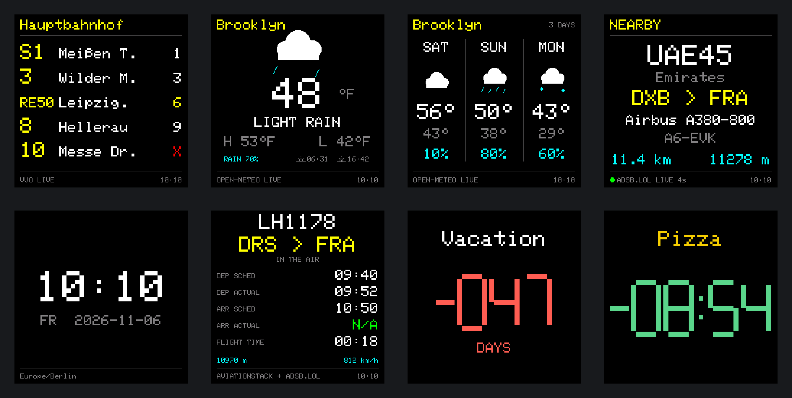
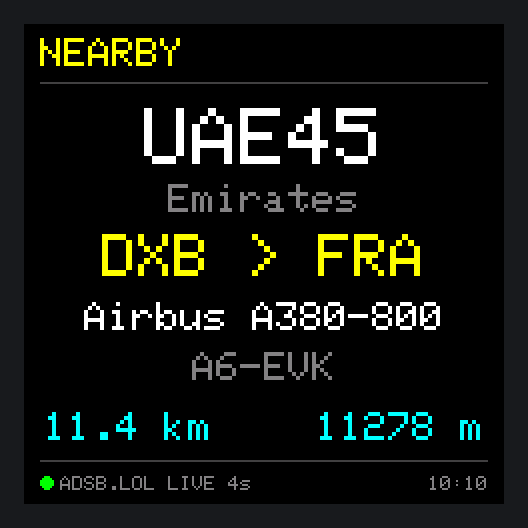
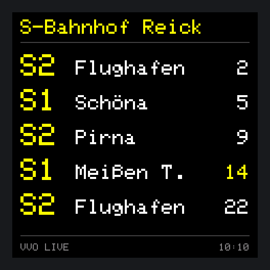
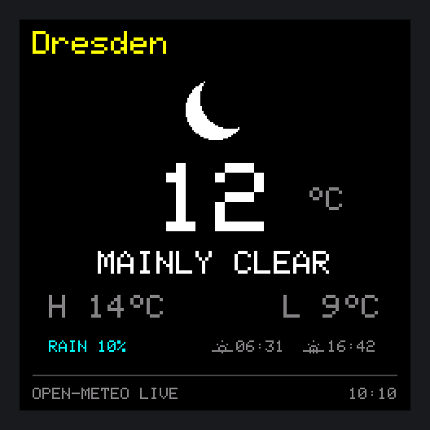
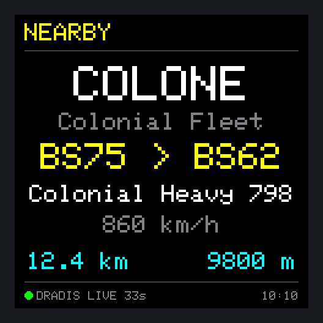
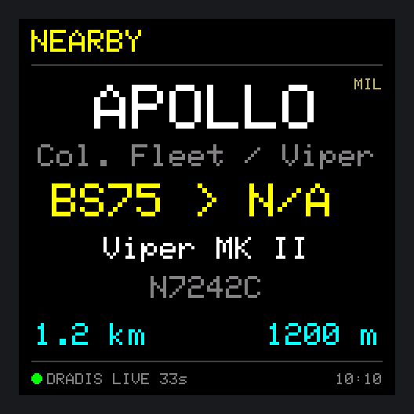
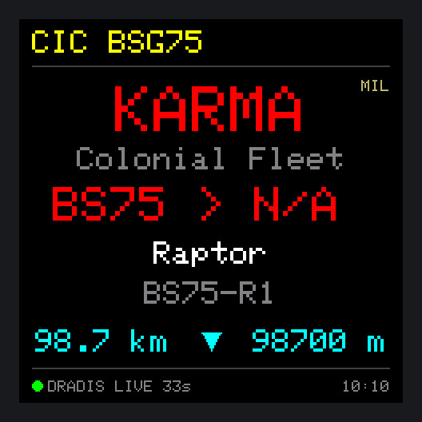

# 🚏 PixelStop

<a href="README.md"><b>← Deutsche Version</b></a>

**Departures, weather, flight radar, clock and countdowns for the GeekMagic SmallTV-Ultra.**
Bought as a small Wi-Fi cube with a rather modest stock firmware – and from day one with the plan to turn it into something of my own.

[](https://github.com/du13500/pixelstop/actions/workflows/build.yml)


<p align="center"></p>
<p align="center"><sub>All images are real firmware output with sample data, generated by <code>tools/render_screens.py</code>.</sub></p>

## What is PixelStop?

PixelStop is a custom firmware in German and English for the **GeekMagic SmallTV-Ultra**, a 240 × 240 pixel cube with an ESP8266. Once set up it only needs USB power and Wi-Fi – **no server, no Raspberry Pi**. Everything is configured in a web interface in your browser.

The cube shows, in rotation or permanently:

| View | What you see |
| --- | --- |
| **Departures** | Live departures of a stop of Verkehrsverbund Oberelbe (VVO, Dresden region): line, destination, minutes, delays and cancellations; up to ten departures on two pages, filter by mode of transport |
| **Weather** | Current temperature, day/night weather icon, high and low, chance of rain, sunrise and sunset; °C or °F |
| **3-day forecast** | Weekday, weather icon, high/low and rain for the next three days, as a view of its own in the rotation |
| **Flight radar** | The nearest aircraft within the chosen radius: callsign, airline, route, type, registration, distance and altitude; optionally speed, ▲▼ for climb/descent, military marking and filters (e.g. hide helicopters). Emergencies (squawk 7500/7600/7700) appear in red |
| **Clock** | Time and date with a selectable time zone |
| **Flight tracker** | One specific flight with scheduled and actual times and live altitude (your own aviationstack key required) |
| **Countdown 1–4** | Four independent timers with their own title and colours – in days, hours or minutes |

Plus night mode, brightness down to 1 %, place search with a map, Greek and Cyrillic characters, and a diagnostics view.

## Gallery

| | | |
| :---: | :---: | :---: |
| <br><sub><b>Departures</b> · Dresden Hauptbahnhof with a delay (yellow) and a cancellation (✕)</sub> | <br><sub><b>Weather</b> · Brooklyn in °F</sub> | <br><sub><b>Flight radar</b> · Emirates A380 from Dubai to Frankfurt</sub> |
| <br><sub><b>Flight tracker</b> · one flight with scheduled and actual times</sub> | <br><sub><b>Forecast</b> · the next three days</sub> | <br><sub><b>Countdown</b> · in days or as a timer</sub> |

### More examples

<details><summary><b>Departures & weather</b></summary>

| | |
| :---: | :---: |
| <br><sub><b>Destinations</b> · town of the stop dropped, “Meißen T.” abbreviated</sub> | <br><sub><b>Weather</b> · Dresden at night in °C</sub> |

</details>

<details><summary><b>Clock & countdown</b></summary>

| | |
| :---: | :---: |
| <br><sub><b>Clock</b> · with date</sub> | <br><sub><b>Countdown</b> · as a minute timer</sub> |

</details>

## Status: v0.5.4.1-dev

| Area | Status |
| --- | --- |
| Departures (VVO), weather, clock, countdowns | ✅ stable in daily use |
| Flight radar over HTTP/1.1, pauses on rejected requests | ✅ confirmed on hardware (v0.4.14.7) |
| Radar only while visible | ✅ running on hardware (v0.4.14.8) |
| Quota guard for adsb.lol (30 s to month), counters across restarts | ⏳ hardware test pending (v0.5.4) |
| Backlight at 1 % without flashes | ⚠️ occasional flashes, sigma-delta test running (v0.5.3) |
| German/English language switch, abbreviated destinations | ✅ confirmed on hardware (v0.5.0) |
| 3-day forecast, tidier web interface, “Show now”, town of the stop | ✅ confirmed on hardware (v0.5.1) |
| Radar: distance and altitude continued between requests, status dot | ✅ confirmed on hardware (v0.5.2) |
| Radar options and filters, aircraft types, forecast as a view | ✅ running on hardware (v0.5.3) |
| Protection against foreign web pages, rescue mode, reconnect after power cuts, network watchdog, compressed web interface | ⏳ hardware test pending (v0.5.4) |
| Flight tracker with your own aviationstack key | ⏳ not fully tested on hardware |

All changes are listed in [`CHANGELOG.md`](CHANGELOG.md) (German), open checks in [`ROADMAP.md`](ROADMAP.md).

## How it works

```
  Browser (phone/PC)                     PixelStop cube (ESP8266)
 ┌──────────────────────┐  Wi-Fi   ┌──────────────────────────────────┐
 │ Web interface        │◀────────▶│ Web server · settings            │
 │ Place search + map ──┼─▶ OSM    │ Requests: VVO ───── departures   │
 └──────────────────────┘          │           Open-Meteo  weather    │
                                   │           adsb.lol ── radar      │
                                   │           aviationstack tracker  │
                                   │ Display 240 × 240 (ST7789)       │
                                   └──────────────────────────────────┘
```

The cube queries the services itself and draws the views directly. Place search runs in the browser so that the ESP8266's scarce memory stays free. The flight radar only polls while it is on screen (plus shortly before it appears) and budgets adsb.lol's daily quota by itself when no key is set. Between two requests it continues distance and altitude from speed, track and vertical rate, so the values stay alive even with rare requests.

## Supported device

**GeekMagic SmallTV-Ultra with ESP8266 / ESP-12F, 4 MB flash and ST7789 display (240 × 240).** Other SmallTV models are untested. The firmware is not meant for ESP32 devices.

## Installation and setup

1. Flash the firmware onto the SmallTV-Ultra. The first flashing method depends on the installed firmware; the USB power port alone is not a guaranteed programming interface.
2. On first start, join the Wi-Fi **PixelStop-Setup** and open **192.168.4.1** in your browser.
3. Under **System**, pick your Wi-Fi, enter the password and save.
4. After the restart, open the web interface via the IP address on the display, or via `pixelstop.local` depending on your network.
5. Under **System → Sprache / Language**, choose English.
6. Under **Display**, set views, rotation times, time zone, brightness and night mode, then the stop, places and timers in their tabs.

> **Note:** Weather and flight radar have independent locations (place search, map or coordinates). An optional display name replaces the place name on screen. An empty Wi-Fi password field keeps the stored password.

**Updates** go through **System → Firmware update** with the matching `.bin`. Settings are kept.

## Building the firmware

The workflow [`build.yml`](.github/workflows/build.yml) builds the firmware on every push and pull request; the result is available under **Actions** as the artifact `pixelstop-v<version>-firmware`. A tag such as `v0.5.0` (matching `FW_VERSION` in [`src/Version.h`](src/Version.h)) also creates a **GitHub release** with the BIN file, checksum and companion package. Locally, `pio run -e smalltv_ultra` is enough.

The screenshots in this README are produced from the real display code by `python3 tools/render_screens.py docs/screens --frame --sheet`.

## Data sources and limits

| Service | Used for | Note |
| --- | --- | --- |
| **VVO** | Departures | Dresden / Upper Elbe region |
| **Open-Meteo** | Weather | free API for non-commercial use |
| **adsb.lol** | Radar positions, routes | data under ODbL; fixed quotas per hour, day, week and month (see below) |
| **adsbdb** | Airline, aircraft type, routes | separate reuse terms for route data |
| **aviationstack** | Flight tracker | your own key, plan limits |
| **OpenStreetMap / Nominatim** | Map, place names | manual search only, via the browser |

The data sources are meant for non-commercial use only; this also applies to PixelStop as a hobby project. The ESP8266 does not verify certificates on HTTPS connections (not enough memory for certificate chains). The connections are encrypted, but someone with access to your own network could in theory sit in between and read, for example, the adsb.lol key.

Radar routes come from additional databases and can be wrong or incomplete despite a position check; unsuitable routes are not replaced by guessed airports. `N/A` means missing data, `GND` an aircraft explicitly reported on the ground. Altitudes are flight altitudes, not height above ground. More in [`THIRD_PARTY_SERVICES.md`](THIRD_PARTY_SERVICES.md).

### Key for adsb.lol

adsb.lol hands out free keys; with a key every device gets its own quota. Enter the key in the **Flight radar** tab, where the links are shown as well.

A free key allows **5 requests per 30 s, 20 per minute, 150 per hour, 500 per day, 2,000 per week and 5,000 per month** (windows in UTC: full hour, midnight, Monday, first of the month). Exceeding them repeatedly can cost the key. PixelStop therefore counts every request (also across restarts and power cuts), plans with a safety margin and spreads the requests so that no limit is reached. It only asks while the radar is shown. With the radar as the only view, the monthly limit sets the pace (about every 9 minutes); in a rotation with other views correspondingly more often. Distance and altitude are continued in between. Usage and the actual interval are listed under **System → Status**.

| Way | For whom |
| --- | --- |
| [Anonymous key](https://www.adsb.lol/pow/challenge) | no account, no email: a small puzzle in the browser, valid for about a month, then simply get a new one |
| [Receiver key](https://www.adsb.lol/receiver) | if you run an ADS-B receiver that feeds adsb.lol; long-lived |
| [Key on request](https://www.adsb.lol/request) | for all other projects, reviewed by hand |

All ways are listed at [adsb.lol/mmb](https://www.adsb.lol/mmb). If adsb.lol rejects a key, it has usually expired; the web interface then points this out.

| Radar footer | Meaning |
| --- | --- |
| `● ADSB.LOL LIVE 4s` | last successful update 4 seconds ago |
| `LAST DATA 16s` | update failed, previous data is shown for a short while |
| `PAUSED 46s` | adsb.lol asks for a pause; age of the last update |
| `NO AIRCRAFT` | request succeeded, but nothing within the radius |
| `ADSB.LOL / Access denied` | adsb.lol rejects requests (401/403/426); long pause instead of constant retries |

| Footer dot | Meaning |
| --- | --- |
| ⚪ briefly white | new data just arrived |
| 🟢 green | updates on schedule; distance and altitude are continued in between |
| 🟡 yellow | update overdue, failed or provider pause; values are estimated |
| ⚫ grey | no data for too long; distance and altitude stand still |

### Flight radar: display and settings

The **Flight radar** tab lets you adjust the view:

- **Operator:** name of the callsign (default), branch, or both, e.g. “US Air Force / AMC” – for known military callsigns.
- **Speed** in km/h or knots, alternating with the registration every 3 seconds.
- **▲▼** between distance and altitude when climbing or descending faster than 300 ft/min.
- **MIL** next to the callsign for military aircraft.
- **Hide:** helicopters, light aircraft, gliders/balloons/ultralights/drones, aircraft on the ground.
- **Always on:** emergencies (squawk 7500/7600/7700) with a red callsign and a red route line in which the route and “SQUAWK 7700” alternate every 3 s; airports with 3-letter IATA or 4-character ICAO codes.

For illustration, a view from Galactica’s CIC:

| | |
| :---: | :---: |
| <br><sub><b>Speed</b> alternating with the registration, 4-character codes, “N/A” when the data has no altitude</sub> | <br><sub><b>MIL</b> marking, operator as “branch / unit”</sub> |

<p align="center"><br><sub><b>Emergency</b> · callsign and route line in red; route and “SQUAWK 7700” alternate every 3 s, with ▼ while descending, distance, altitude and age running on, custom display name in the header</sub></p>

<sub>Fictional sample data inspired by Battlestar Galactica, not affiliated with the rights holders. For these images the footer source reads “DRADIS” instead of “ADSB.LOL”; everything else is unchanged firmware output.</sub>

## Plans

- **More regions:** departures not only from VVO but selectable per transport association or Germany-wide (planned for v0.6.0).
- **Custom destination replacements** in the web interface.
- English diagnostics texts.
- **Fallback sources for the radar** (airplanes.live, adsb.fi) when the adsb.lol quota is used up (planned for v0.5.5).

## Diagnostics and bug reports

Under **System → Diagnostics**, **Load log** shows the latest events. After a glitch, load the log right away; after a restart only the reset reason and the last marker remain. If the web interface does not respond, the address `http://<IP>/api/log` often still works.

**Self-help of the firmware:**

- **Power cut:** if the router starts more slowly than the cube, the cube waits in the setup hotspot and retries the stored Wi-Fi every minute – but not while a device is connected to the hotspot.
- **Network hang:** 10 minutes without a single answer despite requests lead to a new Wi-Fi connection, 5 minutes later to a restart (the marker is kept).
- **Rescue mode:** after three crashes in quick succession PixelStop starts without requests; the web interface and firmware update work, the display shows “RESCUE MODE”. A normal restart ends it.
- **Foreign web pages** can neither change settings nor install firmware; tools like `curl` on the home network keep working. Helpful for bug reports: firmware version, affected view, steps to reproduce and a photo. Please **never publish Wi-Fi passwords or API keys**.

## Credits and license

- Own project code and documentation: **MIT**, Copyright (c) 2026 du13500. Keep the copyright and license notice when redistributing.
- Hardware and display basis from [smalltv-mod](https://github.com/giovi321/smalltv-mod) by giovi321 (WTFPL); the original notice is included.
- Libraries and their licenses: see [`THIRD_PARTY_NOTICES.md`](THIRD_PARTY_NOTICES.md) and [`LICENSES/`](LICENSES).
- Language flag: [English_language.svg](https://commons.wikimedia.org/wiki/File:English_language.svg) by Rei-artur and Kjoonlee, Wikimedia Commons, public domain.
- Map data © OpenStreetMap contributors.

---

**Know before you go. 🚏**

<sub>PixelStop is an independent hobby project and is not affiliated with GeekMagic, VVO or any of the data providers named above.</sub>
