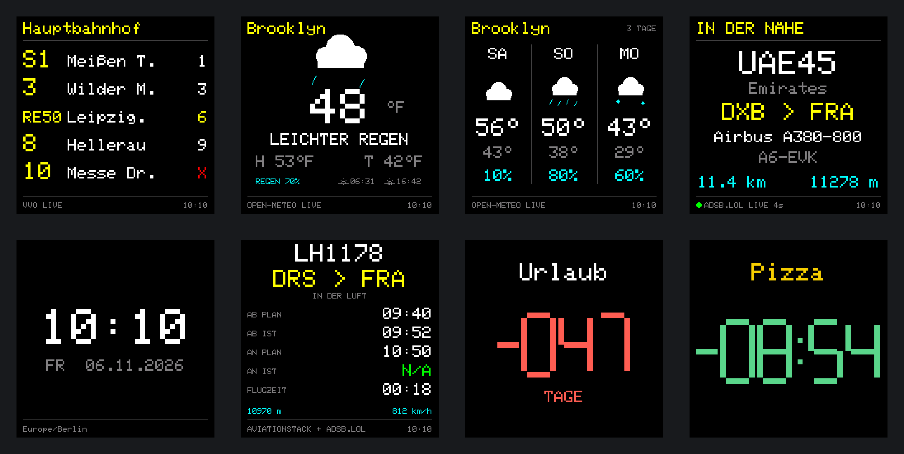
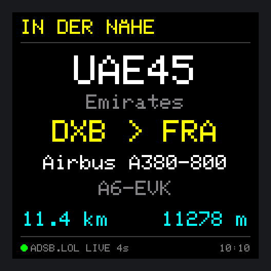
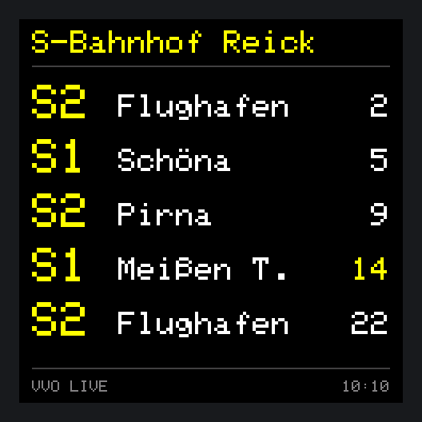
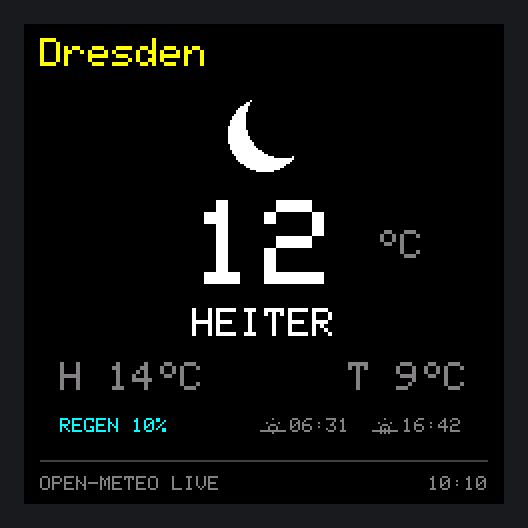
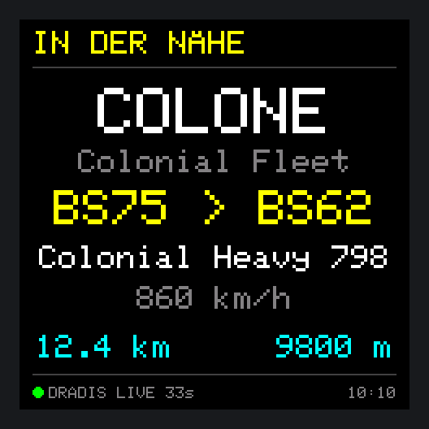
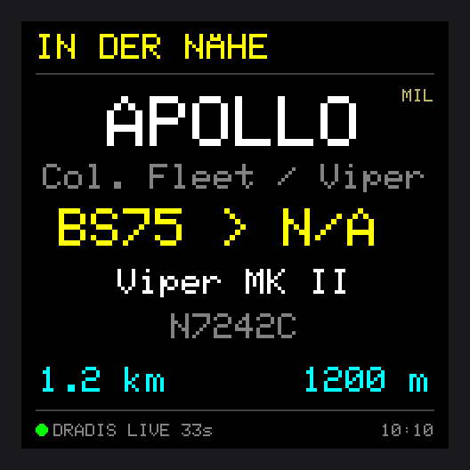
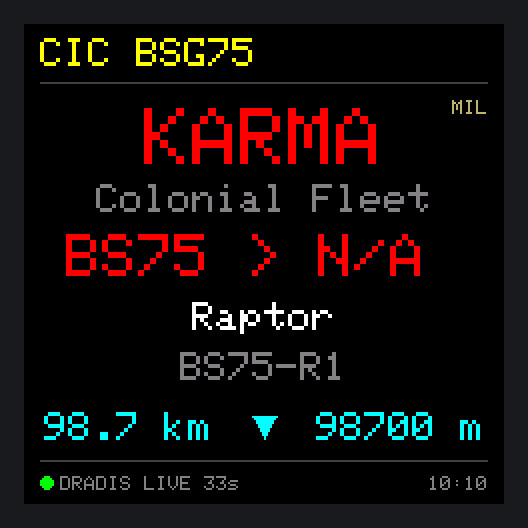

# 🚏 PixelStop

<a href="README.en.md"> <b>English version →</b></a>

**Abfahrten, Wetter, Flugradar, Uhr und Countdowns für den GeekMagic SmallTV-Ultra.**
Gekauft als kleiner WLAN-Würfel mit eher bescheidener Werksfirmware – und von Anfang an mit dem Plan, etwas Eigenes daraus zu machen.

[](https://github.com/du13500/pixelstop/actions/workflows/build.yml)


<p align="center"></p>
<p align="center"><sub>Alle Bilder sind echte Ausgaben der Firmware mit Beispieldaten, erzeugt mit <code>tools/render_screens.py</code>.</sub></p>

## Was ist PixelStop?

PixelStop ist eine eigene, deutschsprachige (und englische) Firmware für den **GeekMagic SmallTV-Ultra**, einen 240 × 240-Pixel-Würfel mit ESP8266. Nach der Einrichtung braucht er nur USB-Strom und WLAN – **kein eigener Server, kein Raspberry Pi**. Alle Einstellungen laufen über ein Webinterface im Browser.

Der Würfel zeigt im Wechsel oder dauerhaft:

| Ansicht | Was du siehst |
| --- | --- |
| **Abfahrten** | Live-Abfahrten einer Haltestelle des Verkehrsverbunds Oberelbe (VVO): Linie, Ziel, Minuten, Verspätungen und Ausfälle; bis zu zehn Abfahrten auf zwei Seiten, Filter nach Verkehrsmittel |
| **Wetter** | Aktuelle Temperatur, Wetterbild für Tag und Nacht, Höchst- und Tiefstwert, Regenwahrscheinlichkeit, Sonnenauf- und -untergang; °C oder °F |
| **3-Tage-Vorhersage** | Wochentag, Wetterbild, Höchst-/Tiefstwert und Regen für die nächsten drei Tage, als eigene Ansicht in der Rotation |
| **Flugradar** | Das nächste Flugzeug im gewählten Umkreis: Callsign, Airline, Route, Typ, Kennzeichen, Entfernung und Höhe; wahlweise Geschwindigkeit, ▲▼ bei Steig-/Sinkflug, Militär-Markierung und Filter (z. B. Hubschrauber ausblenden). Notfälle (Squawk 7500/7600/7700) erscheinen rot |
| **Uhr** | Uhrzeit und Datum mit wählbarer Zeitzone |
| **Flug-Tracker** | Ein bestimmter Flug mit Plan- und Ist-Zeiten und Live-Höhe (eigener aviationstack-Schlüssel nötig) |
| **Countdown 1–4** | Vier unabhängige Timer mit eigenem Titel und Farben – in Tagen, Stunden oder Minuten |

Dazu kommen Nachtmodus, Helligkeit ab 1 %, Ortssuche mit Karte, griechische und kyrillische Zeichen sowie eine Diagnoseansicht.

## Galerie

| | | |
| :---: | :---: | :---: |
| <br><sub><b>Abfahrten</b> · Dresden Hauptbahnhof, mit Verspätung (gelb) und Ausfall (✕)</sub> | <br><sub><b>Wetter</b> · Brooklyn in °F</sub> | <br><sub><b>Flugradar</b> · Emirates A380 von Dubai nach Frankfurt</sub> |
| <br><sub><b>Flug-Tracker</b> · ein Flug mit Plan- und Ist-Zeiten</sub> | <br><sub><b>Vorhersage</b> · die nächsten drei Tage</sub> | <br><sub><b>Countdown</b> · in Tagen oder als Timer</sub> |

### Mehr Beispiele

<details><summary><b>Abfahrten & Wetter</b></summary>

| | |
| :---: | :---: |
| <br><sub><b>Fahrtziele</b> · Ort der Haltestelle ausgeblendet, „Meißen T.“ abgekürzt</sub> | <br><sub><b>Wetter</b> · Dresden nachts in °C</sub> |

</details>

<details><summary><b>Uhr & Countdown</b></summary>

| | |
| :---: | :---: |
| <br><sub><b>Uhr</b> · mit Datum</sub> | <br><sub><b>Countdown</b> · als Minuten-Timer</sub> |

</details>

## Entwicklungsstand: v0.5.4.2-dev

| Bereich | Stand |
| --- | --- |
| Abfahrten (VVO), Wetter, Uhr, Countdowns | ✅ im Alltag stabil |
| Flugradar über HTTP/1.1, Pausen bei abgelehnten Anfragen | ✅ auf Hardware bestätigt (v0.4.14.7) |
| Radar nur bei sichtbarer Ansicht | ✅ läuft auf Hardware (v0.4.14.8) |
| Kontingent-Wächter für adsb.lol (30 s bis Monat), Zähler über Neustarts | ⏳ Hardwaretest offen (v0.5.4) |
| Hintergrundbeleuchtung bei 1 % ohne Aufblitzen | ⚠️ gelegentliches Aufblitzen, Test mit Sigma-Delta läuft (v0.5.3) |
| Sprachumschaltung Deutsch/Englisch, abgekürzte Fahrtziele | ✅ auf Hardware bestätigt (v0.5.0) |
| 3-Tage-Vorhersage, aufgeräumtes Webinterface, „Jetzt anzeigen“, Ort der Haltestelle | ✅ auf Hardware bestätigt (v0.5.1) |
| Radar: Entfernung und Höhe zwischen den Abrufen weitergerechnet, Statuspunkt | ✅ auf Hardware bestätigt (v0.5.2) |
| Radar-Optionen und Filter, Flugzeugtypen, Vorhersage als Ansicht | ✅ läuft auf Hardware (v0.5.3) |
| Schutz gegen fremde Webseiten, Rettungsmodus, Wiederverbinden nach Stromausfall, Netzwerk-Wächter, komprimiertes Webinterface | ⏳ Hardwaretest offen (v0.5.4) |
| Flug-Tracker mit eigenem aviationstack-Schlüssel | ⏳ nicht vollständig auf Hardware getestet |

Alle Änderungen stehen in [`CHANGELOG.md`](CHANGELOG.md), offene Prüfungen in [`ROADMAP.md`](ROADMAP.md).

## So funktioniert es

```
  Browser (Handy/PC)                     PixelStop-Würfel (ESP8266)
 ┌──────────────────────┐   WLAN   ┌──────────────────────────────────┐
 │ Webinterface         │◀────────▶│ Webserver · Einstellungen        │
 │ Ortssuche + Karte ───┼─▶ OSM    │ Abrufe:  VVO ─────── Abfahrten   │
 └──────────────────────┘          │          Open-Meteo ─ Wetter     │
                                   │          adsb.lol ─── Flugradar  │
                                   │          aviationstack  Tracker  │
                                   │ Display 240 × 240 (ST7789)       │
                                   └──────────────────────────────────┘
```

Der Würfel fragt die Dienste selbst ab und zeichnet die Ansichten direkt. Die Ortssuche läuft über den Browser, damit der knappe Arbeitsspeicher des ESP8266 frei bleibt. Das Flugradar fragt nur, solange es auf dem Display steht (plus kurz vor dem Wechsel), und teilt sich ohne eigenen Schlüssel das Tageskontingent von adsb.lol selbst ein. Zwischen zwei Abrufen rechnet es Entfernung und Höhe aus Geschwindigkeit, Kurs und Steigrate weiter, sodass die Werte auch bei seltenen Abrufen lebendig bleiben.

## Unterstütztes Gerät

**GeekMagic SmallTV-Ultra mit ESP8266 / ESP-12F, 4 MB Flash und ST7789-Display (240 × 240).** Andere SmallTV-Modelle sind nicht getestet. Die Firmware ist nicht für ESP32-Geräte bestimmt.

## Installation und Einrichtung

1. Die Firmware auf den SmallTV-Ultra bringen. Der erste Flashweg hängt von der vorhandenen Firmware ab; der USB-Stromanschluss allein ist kein zugesicherter Programmierzugang.
2. Beim ersten Start mit dem WLAN **PixelStop-Setup** verbinden und im Browser **192.168.4.1** öffnen.
3. Unter **System** das WLAN wählen, Passwort eintragen und speichern.
4. Nach dem Neustart das Webinterface über die IP-Adresse auf dem Display öffnen, je nach Netzwerk auch über `pixelstop.local`.
5. Unter **System → Sprache / Language** Deutsch oder Englisch wählen.
6. Unter **Anzeige** Programme, Wechselzeiten, Zeitzone, Helligkeit und Nachtmodus einstellen, danach Haltestelle, Orte und Timer in den jeweiligen Reitern.

> **Hinweis:** Wetter und Flugradar haben unabhängige Standorte (Ortssuche, Karte oder Koordinaten). Ein optionaler Anzeigename ersetzt den Ortsnamen auf dem Display. Ein leeres WLAN-Passwortfeld behält das gespeicherte Passwort.

**Updates** laufen über **System → Firmware-Update** mit der passenden `.bin`. Die Einstellungen bleiben dabei erhalten.

## Firmware bauen

Der Workflow [`build.yml`](.github/workflows/build.yml) baut die Firmware bei jedem Push und Pull Request; das Ergebnis liegt unter **Actions** als Artefakt `pixelstop-v<Version>-firmware`. Ein Tag wie `v0.5.0` (passend zu `FW_VERSION` in [`src/Version.h`](src/Version.h)) erzeugt zusätzlich ein **GitHub Release** mit BIN-Datei, Prüfsumme und Begleitpaket. Lokal genügt `pio run -e smalltv_ultra`.

Die Screenshots dieser README erzeugt `python3 tools/render_screens.py docs/screens --frame --sheet` aus dem echten Displaycode.

## Datenquellen und Grenzen

| Dienst | Wofür | Hinweis |
| --- | --- | --- |
| **VVO** | Abfahrten | Region Dresden/Oberelbe |
| **Open-Meteo** | Wetter | kostenlose API für nichtkommerzielle Nutzung |
| **adsb.lol** | Radarpositionen, Routen | Daten unter ODbL; feste Kontingente pro Stunde, Tag, Woche und Monat (siehe unten) |
| **adsbdb** | Airline, Flugzeugtyp, Routen | eigene Weiterverwendungsbedingungen für Routen |
| **aviationstack** | Flug-Tracker | eigener Schlüssel, Tarifgrenzen |
| **OpenStreetMap / Nominatim** | Karte, Ortsnamen | nur manuelle Suche, über den Browser |

Die Datenquellen sind nur für nicht-kommerzielle Nutzung gedacht; das gilt auch für PixelStop als Hobbyprojekt. Der ESP8266 prüft bei HTTPS-Verbindungen keine Zertifikate (zu wenig Speicher für Zertifikatsketten). Die Verbindungen sind verschlüsselt, aber jemand mit Zugriff auf das eigene Netz könnte sich theoretisch dazwischenschalten und z. B. den adsb.lol-Schlüssel mitlesen.

Radar-Routen stammen aus Zusatzdatenbanken und können trotz Positionsprüfung falsch oder unvollständig sein; unpassende Routen werden nicht durch geratene Flughäfen ersetzt. `N/A` steht für fehlende Daten, `GND` für ein ausdrücklich gemeldetes Flugzeug am Boden. Höhen sind Flughöhen, keine Höhe über Grund. Weitere Hinweise in [`THIRD_PARTY_SERVICES.md`](THIRD_PARTY_SERVICES.md).

### Schlüssel für adsb.lol

adsb.lol vergibt kostenlose Schlüssel; mit Schlüssel hat jedes Gerät sein eigenes Kontingent. Den Schlüssel im Reiter **Flugradar** eintragen, dort stehen auch die Links.

Ein kostenloser Schlüssel erlaubt **5 Anfragen pro 30 s, 20 pro Minute, 150 pro Stunde, 500 pro Tag, 2.000 pro Woche und 5.000 pro Monat** (Fenster in UTC: volle Stunde, Mitternacht, Montag, Monatsanfang). Wiederholtes Überschreiten kann den Schlüssel kosten. PixelStop zählt deshalb jede Anfrage (auch über Neustarts und Stromausfälle hinweg), plant mit Sicherheitsabstand und verteilt die Anfragen so, dass keine Grenze erreicht wird. Gefragt wird nur, während das Radar angezeigt wird. Bei Dauerbetrieb nur mit Radar bestimmt das Monatslimit den Takt (etwa alle 9 Minuten); in einer Rotation mit anderen Ansichten entsprechend öfter. Dazwischen werden Entfernung und Höhe weitergerechnet. Verbrauch und tatsächliches Intervall stehen unter **System → Status**.

| Weg | Für wen |
| --- | --- |
| [Anonymer Schlüssel](https://www.adsb.lol/pow/challenge) | ohne Konto und ohne Mail: kleine Rechenaufgabe im Browser, gilt etwa einen Monat, danach einfach neu holen |
| [Schlüssel für Empfänger](https://www.adsb.lol/receiver) | wer selbst einen ADS-B-Empfänger betreibt und an adsb.lol liefert; lange gültig |
| [Schlüssel auf Antrag](https://www.adsb.lol/request) | für alle anderen Projekte, wird von Hand geprüft |

Eine Übersicht aller Wege gibt es unter [adsb.lol/mmb](https://www.adsb.lol/mmb). Lehnt adsb.lol einen Schlüssel ab, ist er meist abgelaufen; das Webinterface weist dann darauf hin.

| Radar-Fußzeile | Bedeutung |
| --- | --- |
| `● ADSB.LOL LIVE 4s` | letzter erfolgreicher Abruf vor 4 Sekunden |
| `LETZTER STAND 16s` | Abruf fehlgeschlagen, vorheriger Stand wird kurz weiter gezeigt |
| `ABRUFPAUSE 46s` | adsb.lol bittet um eine Pause; Alter des letzten Abrufs |
| `KEIN FLUGZEUG` | Abfrage erfolgreich, aber nichts im Umkreis |
| `ADSB.LOL / Zugriff abgelehnt` | adsb.lol lehnt ab (401/403/426); lange Pause statt ständiger Wiederholung |

| Punkt in der Fußzeile | Bedeutung |
| --- | --- |
| ⚪ kurz weiß | gerade neue Daten empfangen |
| 🟢 grün | Abrufe im normalen Takt; Entfernung und Höhe werden dazwischen weitergerechnet |
| 🟡 gelb | Abruf überfällig, fehlgeschlagen oder Anbieterpause; Werte sind geschätzt |
| ⚫ grau | zu lange keine Daten; Entfernung und Höhe stehen still |

### Flugradar: Darstellung und Einstellungen

Im Reiter **Flugradar** lässt sich die Anzeige anpassen:

- **Betreiber:** Name zum Rufzeichen (Standard), Oberbegriff oder beides, z. B. „US Air Force / AMC“ – für bekannte Militär-Rufzeichen.
- **Geschwindigkeit** in km/h oder Knoten, alle 3 Sekunden im Wechsel mit dem Kennzeichen.
- **▲▼** zwischen Entfernung und Höhe bei Steig- oder Sinkflug ab 300 ft/min.
- **MIL** neben dem Rufzeichen für Militärflugzeuge.
- **Ausblenden:** Hubschrauber, Kleinflugzeuge, Segler/Ballone/Ultraleicht/Drohnen, Flugzeuge am Boden.
- **Immer aktiv:** Notfälle (Squawk 7500/7600/7700) mit rotem Rufzeichen und roter Routenzeile, in der Route und „SQUAWK 7700“ alle 3 s wechseln; Flughäfen mit 3-stelligem IATA- oder 4-stelligem ICAO-Code.

Zur Veranschaulichung ein Blick aus dem CIC der Galactica:

| | |
| :---: | :---: |
| <br><sub><b>Geschwindigkeit</b> im Wechsel mit dem Kennzeichen, 4-stellige Codes, „N/A“ wenn der Datenabruf keine Höhe liefert</sub> | <br><sub><b>MIL</b>-Markierung, Betreiber als „Oberbegriff / Einheit“</sub> |

<p align="center"><br><sub><b>Notfall</b> · Rufzeichen und Routenzeile rot; Route und „SQUAWK 7700“ wechseln alle 3 s, dazu ▼ im Sinkflug, Entfernung, Höhe und Alter laufen weiter, eigener Anzeigename in der Kopfzeile</sub></p>

<sub>Fiktive Beispieldaten in Anlehnung an Battlestar Galactica, ohne Verbindung zu den Rechteinhabern. Für diese Bilder heißt die Quelle in der Fußzeile „DRADIS“ statt „ADSB.LOL“; alles andere ist unveränderte Firmware-Ausgabe.</sub>

## Pläne

- **Mehr Regionen:** Abfahrten nicht nur vom VVO, sondern auswählbar je Verkehrsverbund bzw. deutschlandweit (geplant für v0.6.0).
- **Eigene Ersetzungen für Fahrtziele** im Webinterface.
- Englische Diagnosetexte.
- **Ausweichquellen fürs Radar** (airplanes.live, adsb.fi), wenn das adsb.lol-Kontingent aufgebraucht ist (geplant für v0.5.5).

## Diagnose und Fehlerberichte

Unter **System → Diagnose** zeigt **Log laden** die letzten Ereignisse. Nach einem Aussetzer den Log möglichst direkt laden; nach einem Neustart bleiben nur Reset-Grund und letzter Marker erhalten. Ist das Webinterface nicht erreichbar, hilft oft direkt die Adresse `http://<IP>/api/log`.

**Selbsthilfe der Firmware:**

- **Stromausfall:** Startet der Router langsamer als der Würfel, wartet dieser im Setup-Hotspot und versucht das gespeicherte WLAN jede Minute erneut – aber nicht, solange ein Gerät mit dem Hotspot verbunden ist.
- **Netzwerk-Hänger:** 10 Minuten ohne eine einzige Antwort trotz Anfragen führen zu einer neuen WLAN-Verbindung, 5 Minuten später zu einem Neustart (der Marker bleibt erhalten).
- **Rettungsmodus:** Nach drei Abstürzen kurz hintereinander startet PixelStop ohne Abrufe; Webinterface und Firmware-Update funktionieren, auf dem Display steht „RETTUNGSMODUS“. Ein normaler Neustart beendet ihn.
- **Fremde Webseiten** können weder Einstellungen ändern noch eine Firmware einspielen; Werkzeuge wie `curl` im Heimnetz funktionieren weiterhin. Hilfreich für Fehlerberichte sind Firmwareversion, betroffene Ansicht, Schritte zum Nachstellen und ein Foto. Bitte **keine WLAN-Passwörter oder API-Schlüssel** veröffentlichen.

## Credits und Lizenz

- Eigener Projektcode und Dokumentation: **MIT**, Copyright (c) 2026 du13500. Copyright- und Lizenzhinweis bei Weitergabe erhalten.
- Hardware- und Display-Grundlage aus [smalltv-mod](https://github.com/giovi321/smalltv-mod) von giovi321 (WTFPL); der ursprüngliche Hinweis liegt bei.
- Bibliotheken und ihre Lizenzen: siehe [`THIRD_PARTY_NOTICES.md`](THIRD_PARTY_NOTICES.md) und [`LICENSES/`](LICENSES).
- Sprachflagge: [English_language.svg](https://commons.wikimedia.org/wiki/File:English_language.svg) von Rei-artur und Kjoonlee, Wikimedia Commons, gemeinfrei.
- Kartendaten © OpenStreetMap-Mitwirkende.

---

**Know before you go. 🚏**

<sub>PixelStop is an independent hobby project and is not affiliated with GeekMagic, VVO or any of the data providers named above.</sub>
